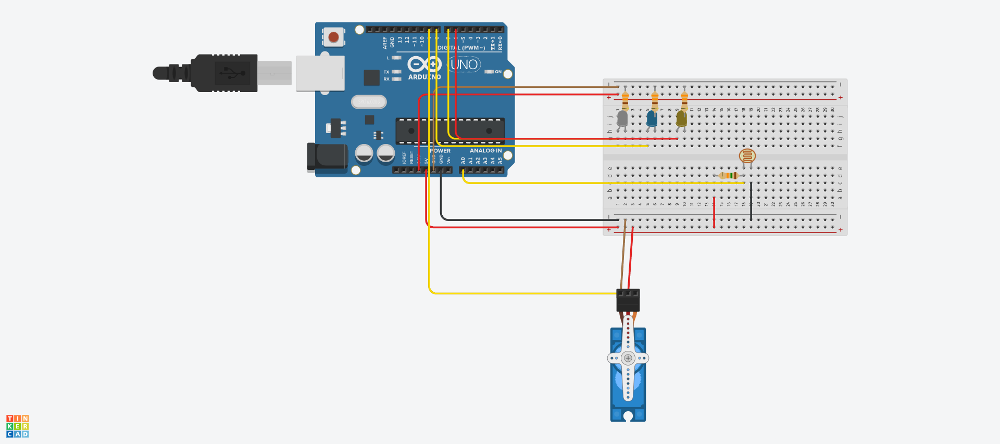

# LumiBot — CitizenTech

Protótipo acadêmico de monitoramento inteligente de iluminação em espaços públicos, desenvolvido no contexto de CitizenTech.

O **LumiBot** utiliza um Arduino Uno para coletar informações de luminosidade por meio de um sensor LDR, movimentar sua cabeça com um servo motor SG90 e controlar três LEDs.

Um **notebook** executa o assistente virtual desenvolvido em Python, responsável pelo reconhecimento de comandos de voz, integração com uma LLM por meio da API Groq e geração de respostas utilizando voz sintetizada.

A estrutura física do robô é construída em papelão, utilizando materiais acessíveis e de baixo custo.

O projeto busca contribuir para a identificação de condições inadequadas de iluminação em ambientes públicos, como praças, calçadas, corredores e pontos de ônibus.

> **Estado do projeto:** integração de software desenvolvida. As leituras do sensor são indicativas e dependem de calibração. O LumiBot é um protótipo acadêmico e não substitui equipamentos profissionais de medição de luminosidade.

---

## 1. Materiais e componentes

O LumiBot utiliza os seguintes componentes:

| Componente | Quantidade | Função |
|---|---|---|
| Arduino Uno | 1 | Controlador principal |
| Sensor LDR | 1 | Monitoramento da luminosidade |
| Servo motor SG90 | 1 | Movimentação da cabeça |
| LED para olho direito | 1 | Sinalização e expressões |
| LED para olho esquerdo | 1 | Sinalização e expressões |
| LED de alerta | 1 | Indicação de iluminação inadequada |
| Resistores de 330 Ω | 3 | Limitação de corrente dos LEDs |
| Resistor de 10 kΩ | 1 | Divisor de tensão, caso o LDR seja avulso |
| Protoboard | 1 | Montagem do circuito |
| Fios jumper | Conforme necessidade | Conexão dos componentes |
| Cabo USB | 1 | Alimentação e comunicação com o notebook |
| Papelão | Conforme necessidade | Estrutura física do robô |

O notebook também é utilizado como microfone, alto-falante e unidade de processamento da Inteligência Artificial.

## Testes e validação do protótipo físico

O LumiBot foi montado fisicamente utilizando Arduino Uno, sensor LDR, três LEDs e servo motor SG90.

A montagem utiliza uma conexão USB com o notebook, responsável pela alimentação do Arduino e pela comunicação com o assistente virtual desenvolvido em Python.

Os componentes eletrônicos foram integrados ao sistema de controle do robô, permitindo a execução das funcionalidades de monitoramento de luminosidade e interação com o usuário.

### Funcionalidades a serem demonstradas

| Funcionalidade | Comportamento esperado |
|---|---|
| Reconhecimento de voz | Identificação dos comandos iniciados pela palavra "Lumi" |
| Cumprimento | Movimentação da cabeça, sinalização luminosa e resposta falada |
| Sensor LDR | Leitura analógica das condições de luminosidade |
| Monitoramento | Classificação das condições de iluminação |
| Sinalização | Acionamento do LED de alerta |
| Inteligência Artificial | Geração de orientações contextualizadas pela LLM |
| Relatório | Registro das leituras e geração de relatório de manutenção |

A montagem física e o funcionamento geral do protótipo foram confirmados.

A calibração do sensor e os resultados individuais dos testes devem ser registrados conforme as medições realizadas no dispositivo.

## 2. Conexões elétricas

### Diagrama do circuito

O diagrama abaixo apresenta a montagem eletrônica do LumiBot, utilizando Arduino Uno, protoboard, sensor LDR, três LEDs e servo motor SG90.



O Arduino Uno é conectado ao notebook por USB, permitindo a alimentação do circuito e a comunicação com o assistente virtual desenvolvido em Python.

O servo SG90 é conectado ao pino digital D9 para receber os comandos de movimentação, enquanto o sensor LDR utiliza a entrada analógica A0 para realizar as leituras de luminosidade.

Os três LEDs são utilizados para representar expressões e sinalizações visuais do robô.

### Arduino Uno

| Componente | Conexão no Arduino |
|---|---|
| Sensor LDR | A0 |
| LED do olho direito | D6 |
| LED do olho esquerdo | D8 |
| LED de alerta | D7 |
| Servo SG90 — sinal | D9 |
| Servo SG90 — alimentação | 5V |
| Servo SG90 — GND | GND |
| Demais componentes | 5V ou GND, conforme o circuito |

Cada LED deve possuir um resistor de 330 Ω conectado em série.

Para um LDR avulso, deve ser utilizado um divisor de tensão com resistor de 10 kΩ. Caso seja utilizado um módulo LDR, é necessário verificar a existência da saída analógica `AO`.

### Alimentação do robô

O LumiBot utiliza uma configuração simplificada de alimentação, dispensando fontes externas e power banks.

O Arduino Uno recebe energia diretamente do notebook por meio de um cabo USB.

O servo motor SG90, os LEDs e o sensor LDR são alimentados pelo próprio Arduino.

**Conexões do servo SG90:**

| Fio | Conexão |
|---|---|
| Vermelho | 5V do Arduino |
| Marrom | GND do Arduino |
| Laranja | Pino digital D9 |

O pino D9 é utilizado exclusivamente para enviar o sinal de controle do servo motor.

**Atenção:** o servo SG90 pode apresentar picos de consumo superiores à corrente disponível pela USB. Caso ocorram reinicializações do Arduino, movimentos irregulares ou aquecimento, será necessário revisar a alimentação do motor.

O projeto não utiliza bateria externa dedicada nem fonte conectada à tomada. Para uma apresentação sem tomada, o notebook poderá funcionar utilizando sua bateria interna.

---

## 3. Estrutura física

A estrutura do LumiBot é construída com papelão, permitindo uma montagem simples e econômica.

### Base

- Largura: 18 cm.
- Profundidade: 18 cm.
- Material: papelão reforçado.
- Função: garantir a estabilidade do robô.

### Corpo

- Largura: 10 cm.
- Profundidade: 8 cm.
- Altura: **18 cm**.

O corpo possui espaço interno para acomodar o Arduino Uno, a protoboard e as conexões elétricas.

Uma abertura traseira permite a passagem do cabo USB e o acesso aos componentes.

### Cabeça

- Largura: 10 cm.
- Altura: 10 cm.
- Profundidade: 10 cm.

A cabeça possui:

- Um Led de alerta utilizado ao verificar baixa iluminação do local
- Dois LEDs utilizados como olhos.
- Sensor LDR posicionado na parte frontal.
- Elementos decorativos que representam a expressão do robô.

O servo SG90 é instalado na parte superior do corpo, com seu eixo conectado à base da cabeça, permitindo movimentos laterais.

A estrutura da cabeça deve permanecer leve para evitar sobrecarga do servo motor.

---

## 4. Tecnologias utilizadas

| Tecnologia | Aplicação |
|---|---|
| Arduino Uno | Controle de sensores e atuadores |
| Arduino IDE | Programação do microcontrolador |
| Python 3.12 | Desenvolvimento do assistente virtual |
| SpeechRecognition | Reconhecimento de comandos de voz |
| PyAudio | Captura de áudio pelo microfone |
| Groq API | Integração com modelo de linguagem |
| edge-tts | Síntese de voz neural |
| pyttsx3 | Síntese de voz alternativa offline |
| PySerial | Comunicação entre Python e Arduino |
| OpenCV | Reconhecimento facial |
| Requests | Consultas a serviços externos |

A comunicação entre Arduino e Python é realizada pela porta serial USB, utilizando a velocidade de 9600 baud.

## 5. Arquitetura de funcionamento

O LumiBot combina processamento embarcado, sensores físicos e Inteligência Artificial.

O funcionamento ocorre em seis etapas:

1. O usuário realiza um comando de voz utilizando a palavra de ativação "Lumi".
2. O Python captura o áudio e converte a fala em texto.
3. O assistente identifica a intenção do comando.
4. Quando necessário, envia instruções ao Arduino Uno pela comunicação serial.
5. O Arduino realiza leituras do sensor LDR e controla LEDs e servo motor.
6. O Python utiliza a LLM para gerar respostas contextualizadas, apresentadas ao usuário por voz sintetizada.

### Integração entre sensor e IA

Quando o usuário solicita uma verificação de iluminação:

1. O Arduino movimenta o servo motor, realizando uma varredura.
2. O sensor LDR coleta informações sobre a luminosidade.
3. O Arduino transmite o valor coletado ao Python.
4. O Python classifica a iluminação conforme limites previamente definidos.
5. O assistente encaminha os dados e o contexto da medição à LLM.
6. A LLM gera uma explicação sobre as condições identificadas.
7. O LumiBot responde por voz e utiliza o LED de alerta quando necessário.

**Importante:** a classificação da luminosidade utiliza limites programados e calibráveis. A Inteligência Artificial generativa é responsável por interpretar o contexto e elaborar orientações e relatórios. O projeto não utiliza um modelo TinyML embarcado.

---

## 6. Instalação

### Requisitos

- Windows.
- Python 3.12.
- Arduino IDE.
- Notebook com microfone e alto-falante.
- Arduino Uno conectado por USB.
- Conexão com a internet para os serviços online.

### 6.1. Configurar o Arduino

1. Abra a Arduino IDE.
2. Conecte o Arduino Uno ao notebook.
3. Selecione a placa **Arduino Uno**.
4. Selecione a porta serial correspondente.
5. Abra o arquivo `arduino/LumeBot/LumeBot.ino`.
6. Compile e envie o código para a placa.

O projeto utiliza a biblioteca `Servo`, disponível na Arduino IDE.

### 6.2. Configurar o Python

Abra o terminal na pasta principal do projeto.

Crie o ambiente virtual:

```powershell
py -3.12 -m venv .venv
```

Ative o ambiente:

```powershell
.venv\Scripts\activate
```

Instale as dependências:

```powershell
pip install -r requirements.txt
```

### 6.3. Configurar a API Groq

Na pasta `python`, crie um arquivo chamado:

`api_AI.txt`

Insira sua chave da API Groq nesse arquivo.

**Nunca publique chaves de API no GitHub.**

O arquivo `api_AI.txt` deve permanecer ignorado pelo Git.

### 6.4. Executar o LumiBot

Conecte o Arduino Uno ao notebook e feche o Monitor Serial da Arduino IDE.

No terminal:

```powershell
cd python
python assistente.py
```

O assistente tentará identificar automaticamente a porta serial do Arduino.

Caso necessário, configure a porta manualmente no arquivo `assistente.py`:

```python
porta_arduino="COM3"
```

Substitua `COM3` pela porta correspondente ao Arduino no seu computador.

### Dependência de internet

Os seguintes recursos dependem de conexão com a internet:

- Reconhecimento de voz pelo serviço do Google.
- Voz neural por meio do `edge-tts`.
- Consultas à LLM pela Groq.
- Consultas de previsão do tempo.

O `pyttsx3` permite síntese de voz offline como alternativa, mas não torna o assistente inteiro independente da internet.

---

## 7. Comandos de voz

O LumiBot utiliza uma palavra de ativação para identificar quando o usuário deseja interagir.

Palavras reconhecidas:

- `lumi`
- `lumibote`
- `lume`
- `lumebote`

É possível falar a palavra de ativação junto com o comando ou utilizá-la separadamente.

### Comandos principais

| Comando de voz | Comportamento |
|---|---|
| "Lumi, olá" | Cumprimenta por voz, movimenta a cabeça e aciona os LEDs |
| "Lumi, verificar iluminação" | Realiza a leitura do LDR e apresenta a análise |
| "Lumi, ligar luz" | Acende os LEDs dos olhos |
| "Lumi, desligar luz" | Apaga os LEDs dos olhos |
| "Lumi, relatório" | Gera um relatório das leituras registradas |

### Funcionalidades adicionais

O assistente também possui funcionalidades desenvolvidas anteriormente no CP4:

| Funcionalidade | Exemplos de comandos |
|---|---|
| Cadastrar evento | "cadastrar evento", "novo evento", "criar evento" |
| Ler agenda | "ler agenda", "mostrar agenda" |
| Limpar agenda | "limpar agenda", "apagar agenda" |
| Consultar horário | "que horas são", "me diz as horas" |
| Consultar data | "que dia é hoje", "qual a data de hoje" |
| Calculadora | "calcular" |
| Reconhecimento facial | "reconhecer face", "quem sou eu" |
| Cadastro facial | "cadastrar rosto", "novo rosto" |
| Previsão do tempo | "clima", "vai chover", "previsão do tempo" |
| Perguntas abertas | Perguntas que não correspondam aos comandos específicos |

Os gatilhos estão definidos no arquivo `python/assistente.py`.

Quando nenhuma funcionalidade específica é identificada, a pergunta é encaminhada à LLM para geração de uma resposta.

### Calculadora

O assistente reconhece operadores como:

- Mais.
- Menos.
- Multiplicado por.
- Dividido por.
- Vezes.
- Elevado.

Exemplo:

"Lumi, calcular 2 mais 3."

---

## 8. Protocolo de comunicação serial

A comunicação entre Python e Arduino é realizada pela porta USB, utilizando 9600 baud.

| Comando | Resposta | Ação |
|---|---|---|
| `OI` | `OK` | Pisca os olhos e movimenta a cabeça |
| `VARRER` | `OK` | Movimenta a cabeça durante a inspeção |
| `LER` | `LDR:<valor>` | Retorna a média de dez leituras do sensor |
| `LUZ` | `LDR:<valor>` e `NIVEL:<nivel>` | Executa uma verificação completa no Arduino |
| `ALERTA:1` | `OK` | Ativa a sinalização de alerta |
| `ALERTA:0` | `OK` | Desativa o LED de alerta |
| `E:1` | `OK` | Acende o olho esquerdo |
| `E:0` | `OK` | Apaga o olho esquerdo |
| `D:1` | `OK` | Acende o olho direito |
| `D:0` | `OK` | Apaga o olho direito |

O Arduino interpreta os comandos recebidos e executa as ações correspondentes.

---

## 9. Calibração do sensor LDR

A calibração é necessária para interpretar corretamente as condições de iluminação.

### Procedimento

1. Conecte o Arduino Uno ao notebook.
2. Abra o Monitor Serial da Arduino IDE.
3. Configure a velocidade para 9600 baud.
4. Envie o comando `LER`.
5. Observe o valor retornado.
6. Ilumine diretamente o sensor e registre o valor.
7. Reduza a iluminação e registre novamente.
8. Compare os resultados.

Os valores analógicos do Arduino Uno normalmente variam entre 0 e 1023.

O código inicial considera:

| Leitura | Classificação |
|---|---|
| Até 500 | Adequada |
| Acima de 500 até 700 | Baixa |
| Acima de 700 | Insuficiente |

Esses valores são referências iniciais e devem ser ajustados conforme o comportamento real do circuito.

**Atenção:** essa classificação pressupõe que valores maiores representam menor luminosidade. Dependendo da ligação do LDR, o comportamento pode ser inverso.

Os limites podem ser modificados em:

- `python/assistente.py`
- `arduino/LumeBot/LumeBot.ino`

---

## 10. Testes e validação

Antes da apresentação, recomenda-se verificar individualmente o funcionamento de todos os componentes.

### 10.1. Testes do Arduino

No Monitor Serial, execute:

| Comando | Resultado esperado |
|---|---|
| `OI` | Movimento da cabeça e animação dos LEDs |
| `VARRER` | Movimento lateral da cabeça |
| `LER` | Exibição do valor do sensor LDR |
| `LUZ` | Leitura, classificação e resposta visual |
| `ALERTA:1` | Ativação do LED de alerta |
| `ALERTA:0` | Desativação do LED de alerta |
| `E:1` | Acendimento do olho esquerdo |
| `E:0` | Desligamento do olho esquerdo |
| `D:1` | Acendimento do olho direito |
| `D:0` | Desligamento do olho direito |

### 10.2. Testes de integração com Python

Com o Monitor Serial fechado e o assistente executando:

1. Realizar um cumprimento por voz.
2. Verificar o movimento do servo.
3. Acender e apagar os LEDs por voz.
4. Solicitar uma análise de luminosidade.
5. Alterar a iluminação do ambiente.
6. Verificar a classificação obtida.
7. Ouvir a resposta gerada pela IA.
8. Solicitar a geração de um relatório.

### 10.3. Teste da alimentação

Verificar se o robô permanece funcionando durante os movimentos do servo motor.

Caso o Arduino apresente reinicializações, falhas de comunicação ou movimentações irregulares, interromper os testes e revisar a alimentação elétrica.

---

## 11. Aplicação no contexto CitizenTech

O LumiBot foi desenvolvido para demonstrar como tecnologias acessíveis podem contribuir para o monitoramento de problemas urbanos.

A iluminação inadequada pode comprometer a visibilidade e dificultar a circulação de pessoas em espaços públicos.

Por meio da integração entre sensores físicos e Inteligência Artificial, o LumiBot permite:

- Identificar alterações nas condições de iluminação.
- Emitir alertas visuais.
- Fornecer informações por voz.
- Gerar relatórios de monitoramento.
- Sugerir ações de manutenção e melhoria da iluminação.

A solução pode servir como base para futuros sistemas de monitoramento de iluminação em escolas, praças, corredores e outros espaços de circulação pública.

---

## 12. Estrutura do repositório

```text
LumiBot-CitizenTech/
├── arduino/
│   └── LumeBot/
│       └── LumeBot.ino
├── python/
│   ├── assistente.py
│   ├── capturar_rosto.py
│   └── treinar_modelo.py
├── requirements.txt
├── .gitignore
└── README.md
```

### Descrição dos arquivos

- `arduino/LumeBot/LumeBot.ino`: código responsável pelo controle dos componentes físicos.
- `python/assistente.py`: assistente virtual, reconhecimento de voz, LLM e comunicação serial.
- `python/capturar_rosto.py`: captura de imagens para reconhecimento facial.
- `python/treinar_modelo.py`: treinamento do modelo de reconhecimento facial.
- `requirements.txt`: dependências do ambiente Python.
- `.gitignore`: exclusão de arquivos temporários, credenciais e dados pessoais.
- `README.md`: documentação técnica do projeto.

---

## 13. Vídeo demonstrativo

O vídeo apresenta o funcionamento do LumiBot, incluindo:

1. O problema da iluminação inadequada em espaços públicos.
2. A proposta de solução no contexto CitizenTech.
3. Os componentes eletrônicos utilizados.
4. A estrutura física construída em papelão.
5. A integração entre Arduino Uno e Python.
6. O funcionamento do sensor LDR.
7. Os comandos de voz e as respostas da IA.
8. A movimentação do servo e a sinalização dos LEDs.
9. A geração de relatórios de monitoramento.

**Link do vídeo:** a adicionar após a gravação e publicação.

O vídeo deverá ter duração máxima de seis minutos, conforme as orientações da atividade.

---

## 14. Considerações finais

O LumiBot demonstra a integração entre computação física, sensores, atuadores e Inteligência Artificial generativa em uma solução voltada ao conceito de CitizenTech.

A utilização de um Arduino Uno, componentes eletrônicos acessíveis e uma estrutura construída em papelão permite desenvolver um protótipo de baixo custo.

A integração com o assistente Python amplia as funcionalidades do dispositivo, possibilitando interação por voz, monitoramento ambiental e geração de respostas contextualizadas.

O projeto representa uma aplicação acadêmica de tecnologias inteligentes para apoiar a identificação e o acompanhamento de problemas relacionados à iluminação em espaços públicos.

---

**Projeto acadêmico — LumiBot CitizenTech**

**Repositório:** https://github.com/CaduValezzi/LumiBot-CitizenTech